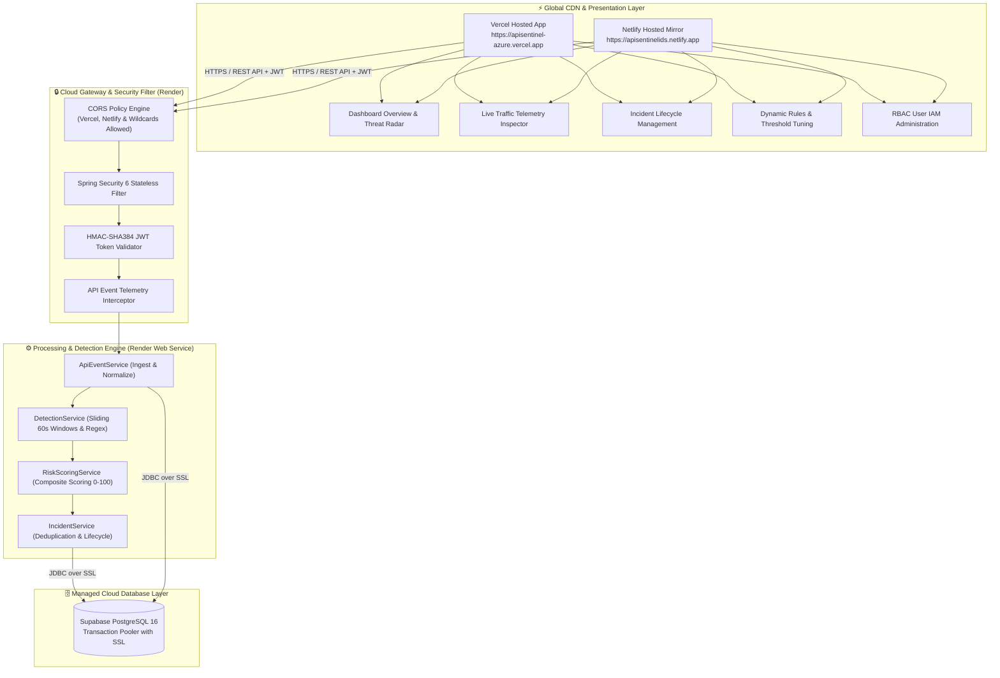
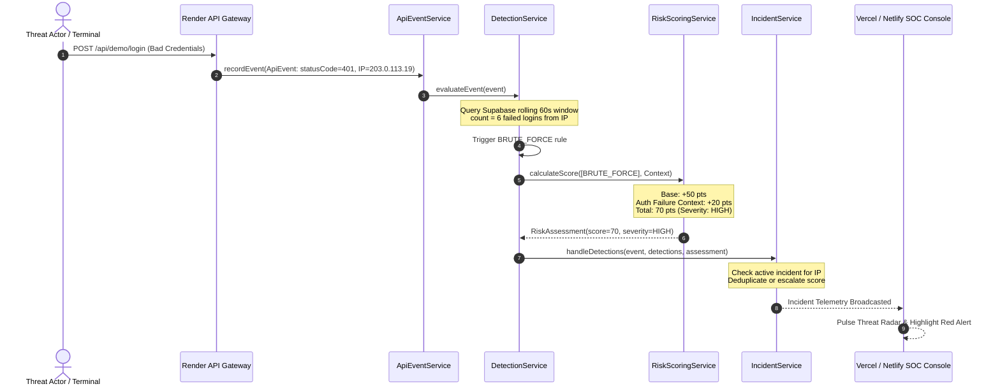
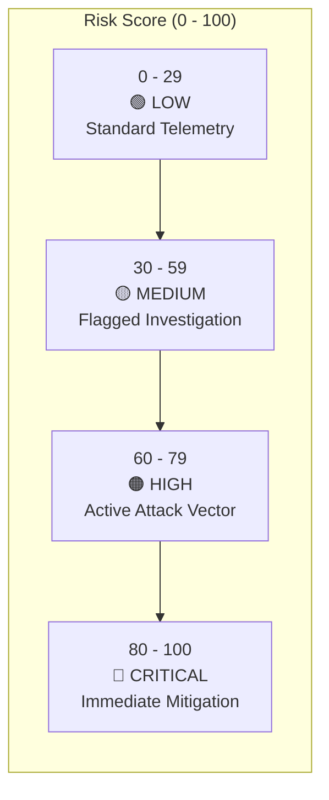

# 🛡️ API Sentinel — Enterprise API Intrusion Detection System

<div align="center">


<p align="center">
  <b>Autonomous, Real-Time API Intrusion Detection, Velocity Analytics & Security Operations Center (SOC)</b>
</p>

<p align="center">
  <a href="#-live-cloud-deployments">Live Deployments</a> •
  <a href="#-default-credentials">Credentials</a> •
  <a href="#-interactive-packet-flow-simulator">Flow Simulator</a> •
  <a href="#-cloud-system-architecture">Architecture</a> •
  <a href="#-end-to-end-data-flow">Data Flow</a> •
  <a href="#-control-flow--decision-tree">Control Flow</a> •
  <a href="#-risk-scoring-engine">Risk Engine</a> •
  <a href="#-attack-simulation-lab-live-cloud-testing">Live Attacks</a> •
  <a href="#-rest-api-specification-reference">API Docs</a> •
  <a href="#-local-development-setup-optional">Local Setup</a>
</p>

</div>

---

> [!NOTE]
> **One-Sentence Platform Overview:**  
> **API Sentinel** is an enterprise-grade API Security & Intrusion Detection System (IDS) deployed in the cloud. It intercepts incoming REST traffic, extracts granular security metadata, detects active threats using deterministic velocity and signature rules, evaluates composite mathematical risk scores (0–100), and provides an ultra-low latency glassmorphism SOC dashboard for incident triage.

---
### Documentations - https://drive.google.com/drive/folders/1TSPrNRYqvjIZmGpoQ0-AgNAlPjnZDY3J?usp=drive_link  

## 🌐 Live Cloud Deployments

API Sentinel is fully hosted and accessible across high-availability cloud platforms:

```
┌──────────────────────────────────────┬────────────────────────────────────────────────────────┐
│ Service Component                    │ Production Cloud Endpoint URL                          │
├──────────────────────────────────────┼────────────────────────────────────────────────────────┤
│ ⚡ SOC Frontend (Vercel Primary)      │ https://apisentinel-azure.vercel.app                  │
│ 🌐 SOC Frontend (Netlify Mirror)     │ https://apisentinelids.netlify.app                    │
│ 🛡️ Backend Engine (Render Service)   │ https://api-sentinel-backend-s0ev.onrender.com         │
│ 🔌 Public REST API Target            │ https://api-sentinel-backend-s0ev.onrender.com/api     │
│ 🗄️ Managed Cloud Database            │ Supabase PostgreSQL 16 (AWS Pooler over SSL)          │
└──────────────────────────────────────┴────────────────────────────────────────────────────────┘
```

> [!TIP]
> **Render Cold Start Notice:** Render free tier instances spin down after inactivity. On initial visit, the first request may take 30–50 seconds to boot the Spring Boot container. Subsequent requests execute in real time (<50ms).

---

## 🔐 Default Credentials

API Sentinel ships with pre-configured role-based test accounts:

```
┌───────────────────────┬──────────────┬──────────────┬─────────────────────────────────────────────────┐
│ Role Level            │ Username     │ Password     │ Access Permissions & Scope                      │
├───────────────────────┼──────────────┼──────────────┼─────────────────────────────────────────────────┤
│ 👑 Administrator      │ admin        │ admin123     │ Full System Control, Rules Tuning, RBAC Users   │
│ 🔍 Security Analyst   │ analyst      │ analyst123   │ Incident Triage, Status Lifecycle, Traffic Logs │
│ 👁️ Auditor / Viewer   │ viewer       │ viewer123    │ Read-Only Metrics, Telemetry & Dashboard View   │
└───────────────────────┴──────────────┴──────────────┴─────────────────────────────────────────────────┘
```

> [!TIP]
> The live console login page features **Evaluator Quick Logins** (`Admin`, `Analyst`, `Viewer`). Clicking any chip automatically pre-fills the credentials and connects directly to the Render cloud backend!

---

## 🎯 What Problem Does API Sentinel Solve?

Modern distributed web architectures expose numerous public REST APIs. Traditional network firewalls only inspect raw TCP/IP headers, while typical Web Application Firewalls (WAFs) struggle to correlate multi-request behavioral patterns across time.

API Sentinel actively mitigates high-impact API attack vectors:

| Attack Vector | Mechanism | Real-World Impact | How API Sentinel Mitigates It |
|---|---|---|---|
| **SQL Injection (SQLi)** | Tautologies (`' OR '1'='1`), stacked queries, comments, `UNION SELECT` | Unauthorized DB exfiltration, authentication bypass | Instant regex AST signature scanning in query params & body payloads |
| **Brute Force & Credential Stuffing** | Rapid 401 velocity targeting `/api/auth/login` | Account takeover, credential dumping | Rolling 60s sliding window threshold (>5 fails = Critical Incident) |
| **API Abuse & Scraping** | High-concurrency requests (>100 req/min) | Denial of Service (DoS), business logic abuse | Per-IP request velocity monitoring with exponential risk weighting |
| **ID Enumeration** | Sequential traversal across numeric entity IDs | Bulk private data harvesting | Behavioral velocity and anomalous path dispersion tracking |

---

## 🎮 Interactive Packet Flow Simulator

Click each scenario below to inspect how the live system evaluates requests:

<details open>
<summary><b>🟢 Scenario 1: Legitimate API Traffic (Pass-Through)</b></summary>

```
[Client / Browser] ──HTTP GET /api/demo/products──▶ [Render Security Gateway] ──Passed──▶ [ApiEvent Ingest]
                                                                                                │
[Supabase DB: Normal Telemetry] ◀──Score: 0 (Normal)── [Detection Engine: 0 Matches] ◀──────────┘
```

1. **Client Request:** `GET /api/demo/products?category=electronics`
2. **Security Gateway:** Verifies session / origin bounds $\to$ Allowed.
3. **Ingestion:** Normalized into an `ApiEvent` (Latency: ~35ms, Status: 200).
4. **Detection Engine:** SQLi regex scan (negative), Brute force count (0), Velocity (within threshold).
5. **Risk Score:** `0` $\to$ Classification: **🟢 NORMAL**.
6. **Result:** Telemetry stored in Supabase PostgreSQL. No incident generated.

</details>

<details>
<summary><b>💉 Scenario 2: SQL Injection Attack (Signature Match)</b></summary>

```
[Attacker] ──GET /api/demo/products?search=' OR '1'='1──▶ [ApiEvent Normalizer]
                                                                   │
                                                                   ▼
[Incident INC-101 (MEDIUM: 30)] ◀──Score: 30── [Regex Match: SQL_INJECTION_PATTERN]
        │
        ▼
[Vercel/Netlify SOC Threat Radar]
```

1. **Malicious Query:** `GET /api/demo/products?search=%27%20OR%20%271%27=%271`
2. **Ingestion:** Encoded parameters decoded and parsed into `ApiEvent`.
3. **Detection Engine ([`DetectionService.java`](file:///c:/java%20project/apisentinel/backend/src/main/java/com/sentinel/api/service/DetectionService.java)):**
   - Matches regex: `('|\")\s*or\s+('?\d+'?|'?[a-zA-Z]+'?)\s*=\s*('?\d+'?|'?[a-zA-Z]+'?)`
   - Generates `DetectionResult` with type `SQL_INJECTION_PATTERN`.
4. **Risk Scoring ([`RiskScoringService.java`](file:///c:/java%20project/apisentinel/backend/src/main/java/com/sentinel/api/service/RiskScoringService.java)):**
   - Base contribution: `+30 points`.
   - Score: `30` $\to$ Severity: **🟡 MEDIUM**.
5. **Incident Service ([`IncidentService.java`](file:///c:/java%20project/apisentinel/backend/src/main/java/com/sentinel/api/service/IncidentService.java)):**
   - Deduplicates or creates `Incident`.
   - Factors JSON: `[{"factor": "SQL injection-like input detected", "points": 30}]`.
6. **Result:** Instantly surfaces on the SOC Threat Radar and Incidents table on Vercel/Netlify.

</details>

<details>
<summary><b>💥 Scenario 3: High-Frequency Brute-Force Attack (Velocity & Context Multiplier)</b></summary>

```
[Botnet IP] ──7x Rapid POST /api/demo/login (401)──▶ [Sliding 60s Window Counter]
                                                                │
                                                                ▼
                                                [Threshold Breached: 7 > 5]
                                                                │
                                                                ▼
[SOC Critical Flash Alert] ◀──Score: 70 (HIGH)── [Risk: 50 Base + 20 Auth Context]
```

1. **Attack Pattern:** Threat actor fires rapid login requests with incorrect credentials within 10 seconds.
2. **Detection Evaluation:**
   - Evaluator counts failed logins for client IP within rolling 60-second window.
   - Count ($7$) exceeds threshold ($5$).
   - Rule `BRUTE_FORCE` is triggered.
3. **Risk Scoring:**
   - Base brute-force contribution: `+50 points`.
   - Context multiplier: Auth failure rate $>75\%$ adds `+20 points`.
   - Composite Score: `50 + 20 = 70` $\to$ Severity: **🟠 HIGH**.
4. **Result:** Escalated incident created, flagged with recommended IP block.

</details>

<details>
<summary><b>🌊 Scenario 4: API Rate Abuse & Scraping Flood</b></summary>

```
[Scraper] ──120 requests in 30s──▶ [ApiEvent Repository] ──Rolling 60s Count: 120──▶ [Threshold: >100]
                                                                                             │
[Incident: Excessive API Usage (Score: 30 - 45)] ◀──Rule Trigger: API_ABUSE ────────────────┘
```

1. **Attack Pattern:** Excessive calls (>100 requests in 60s) from a single IP to harvest endpoints.
2. **Rule Trigger:** `API_ABUSE` fires upon exceeding 100 requests.
3. **Risk Scoring:**
   - Base points: `+15`.
   - High velocity context: `+15`.
   - Score: `30–45` $\to$ Severity: **🟡 MEDIUM**.
4. **Result:** Incident logged with factor `"Excessive API usage"`.

</details>

---

## 🏛️ Cloud System Architecture



| Layer | Component | Cloud Host / Tech | Source File |
|---|---|---|---|
| **Presentation** | SOC Cyber Console | Vercel (`React 18 + Vite`) | [`DashboardPage.tsx`](file:///c:/java%20project/apisentinel/frontend/src/pages/DashboardPage.tsx) |
| **Presentation** | Mirror Deployment | Netlify Edge CDN | [`apisentinelids.netlify.app`](https://apisentinelids.netlify.app) |
| **Presentation** | Live Traffic Inspector | Virtualized Table + Filters | [`TrafficPage.tsx`](file:///c:/java%20project/apisentinel/frontend/src/pages/TrafficPage.tsx) |
| **Presentation** | Rules Configuration | Interactive Thresholds | [`RulesPage.tsx`](file:///c:/java%20project/apisentinel/frontend/src/pages/RulesPage.tsx) |
| **Presentation** | RBAC Administration | IAM Roles & Users | [`UsersPage.tsx`](file:///c:/java%20project/apisentinel/frontend/src/pages/UsersPage.tsx) |
| **Gateway** | Security Filter & CORS | Spring Security 6 on Render | [`SecurityConfig.java`](file:///c:/java%20project/apisentinel/backend/src/main/java/com/sentinel/api/config/SecurityConfig.java) |
| **Gateway** | Cryptographic Auth | HMAC-SHA384 Tokens | [`JwtService.java`](file:///c:/java%20project/apisentinel/backend/src/main/java/com/sentinel/api/security/JwtService.java) |
| **Detection** | Signature & Velocity Engine | Rolling 60s Sliding Windows | [`DetectionService.java`](file:///c:/java%20project/apisentinel/backend/src/main/java/com/sentinel/api/service/DetectionService.java) |
| **Scoring** | Risk Scoring Engine | Additive Score (0–100) | [`RiskScoringService.java`](file:///c:/java%20project/apisentinel/backend/src/main/java/com/sentinel/api/service/RiskScoringService.java) |
| **Persistence** | Relational Store | Supabase Managed PostgreSQL | [`seed_users.sql`](file:///c:/java%20project/apisentinel/backend/src/main/resources/seed_users.sql) |

---

## 🔄 End-to-End Data Flow


---

## 🔀 Control Flow & Decision Tree



---

## 🧮 Risk Scoring Engine & Formula

The [`RiskScoringService.java`](file:///c:/java%20project/apisentinel/backend/src/main/java/com/sentinel/api/service/RiskScoringService.java) computes a mathematical risk score strictly bounded in $[0, 100]$:

$$\text{Risk Score} = \min\left(100, \sum \text{Base Points} + \sum \text{Context Boosts}\right)$$

### Factor Weighting Matrix

```
┌──────────────────────────────────────┬─────────────┬────────────────────────────────────────────────────────┐
│ Detection Factor                     │ Points      │ Condition Trigger                                      │
├──────────────────────────────────────┼─────────────┼────────────────────────────────────────────────────────┤
│ 💥 Brute-Force Behavior              │ +50 pts     │ > 5 failed auth attempts (401) from single IP in 60s   │
│ 💉 SQL Injection Input Signature    │ +30 pts     │ Query or Body matches compiled SQLi regex patterns     │
│ 🌊 Excessive API Usage (Abuse)       │ +15 pts     │ > 100 requests from single IP in 60s                   │
│ ⚠️ High Auth-Failure Rate Context    │ +20 pts     │ Window failure ratio > 75% under burst load            │
│ 📈 Excessive Request Activity Context│ +15 pts     │ Secondary velocity escalation from same origin         │
└──────────────────────────────────────┴─────────────┴────────────────────────────────────────────────────────┘
```

### Severity Classification Thresholds



---

## 🧪 Attack Simulation Lab (Live Cloud Testing)

Sentinel features built-in simulation endpoints to trigger real-time detection on the live cloud instance. You can execute these commands directly from your terminal:

### 1. SQL Injection Attack

Send a boolean tautology query probe against the catalog search:

```bash
# cURL (Bash / Terminal):
curl "https://api-sentinel-backend-s0ev.onrender.com/api/demo/products?search=%27%20OR%20%271%27=%271"

# PowerShell (Windows):
Invoke-RestMethod -Uri "https://api-sentinel-backend-s0ev.onrender.com/api/demo/products?search=%27%20OR%20%271%27=%271" -Method GET
```

**Live Observation:**
- **Trigger:** Immediate regex match (`SQL_INJECTION_PATTERN`).
- **Severity:** `MEDIUM` (Score: 30).
- **Console Feed:** Surfaces on [apisentinel-azure.vercel.app](https://apisentinel-azure.vercel.app) under Incidents.

---

### 2. High-Frequency Brute Force Attack

Execute a rapid burst of failed authentication attempts:

```bash
# Linux / macOS / Git Bash:
for i in {1..7}; do
  curl -s -X POST https://api-sentinel-backend-s0ev.onrender.com/api/demo/login \
       -H "Content-Type: application/json" \
       -d '{"username":"admin","password":"invalid_password_'$i'"}'
done

# PowerShell (Windows):
1..7 | ForEach-Object {
    Invoke-RestMethod -Uri "https://api-sentinel-backend-s0ev.onrender.com/api/demo/login" -Method POST `
        -ContentType "application/json" -Body "{`"username`":`"admin`",`"password`":`"bad_pass_$_`"}" `
        -SkipHttpErrorCheck
}
```

**Live Observation:**
- **Trigger:** $>5$ failed attempts recorded within 60 seconds.
- **Severity:** Escalates to `HIGH` / `CRITICAL` (Score: 70–90).
- **Console Feed:** Threat Radar alerts with `"Brute-force behavior"` and `"High auth-failure rate"`.

---

### 3. API Rate Abuse / Scraping Flood

Flood the order management endpoint to simulate scraping:

```bash
# Bash:
for i in {1..20}; do curl -s "https://api-sentinel-backend-s0ev.onrender.com/api/demo/orders" > /dev/null; done

# PowerShell (Windows):
1..20 | ForEach-Object {
    Invoke-RestMethod -Uri "https://api-sentinel-backend-s0ev.onrender.com/api/demo/orders" -Method GET
}
```

---

## 🖥️ SOC Dashboard Features

The frontend is an ultra-modern glassmorphism Cyber SOC console:

<details open>
<summary><b>✨ SOC Console Capabilities</b></summary>

1. **Dashboard Overview (`/overview`)**:
   - **Hero Threat Radar:** Dynamic SVG pulse radar displaying live system posture.
   - **Risk Area Trend Chart:** Real-time timeline of aggregated threat scores.
   - **Attack Vector Distribution:** Polar breakdown of threat types (Brute-Force vs. SQLi vs. Abuse).
   - **Active Incidents Table:** Live incidents feed with severity tags and factor breakdowns.

2. **Incident Triage & Status (`/incidents`)**:
   - Inspect client IP, target endpoint, timestamps, and mathematical factor contributions.
   - Transition incident status with single-click actions:
     $$\text{OPEN} \longrightarrow \text{INVESTIGATING} \longrightarrow \text{RESOLVED}$$

3. **Live Traffic Telemetry (`/traffic`)**:
   - Filterable stream of every HTTP request with status codes, latency in milliseconds, client IP, and user-agent string.

4. **Dynamic Rules Configuration (`/rules`)**:
   - Real-time toggles to activate/deactivate detection rules.
   - Real-time velocity adjustments (e.g. adjust brute-force trigger threshold from 5 to 10 attempts).

5. **RBAC User Administration (`/users`)**:
   - *(Admin only)* Provision and audit team credentials for Analysts and Auditors.

</details>

---

## 🔌 REST API Specification Reference

### Authentication & Users
- `POST /api/auth/login` — Authenticate and receive signed HMAC-SHA384 JWT.
- `GET /api/users` — *(ADMIN)* List registered accounts and roles.
- `POST /api/users` — *(ADMIN)* Provision a new user account with role.
- `DELETE /api/users/{id}` — *(ADMIN)* Remove user account.

### Telemetry & Incidents
- `GET /api/dashboard/summary` — Aggregated metrics: total events, open incidents, risk score.
- `GET /api/incidents` — List all captured security incidents.
- `GET /api/incidents/{id}` — Fetch detailed incident factor breakdown.
- `PATCH /api/incidents/{id}/status` — *(ADMIN/ANALYST)* Transition lifecycle status.
- `GET /api/events?limit=50` — Retrieve raw incoming API telemetry logs.

### Rules Management
- `GET /api/rules` — List active detection rules and velocity limits.
- `PATCH /api/rules/{id}/enabled` — *(ADMIN)* Toggle rule activation.
- `PUT /api/rules/{id}` — *(ADMIN)* Update threshold count and window seconds.

### Honeypot & Demo Simulation
- `POST /api/demo/login` — Honeypot login endpoint for brute-force tests.
- `GET /api/demo/products?search={payload}` — Product search for SQLi probes.
- `GET /api/demo/orders` — Orders endpoint for velocity flood testing.

---

## 💻 Local Development Setup (Optional)

If you wish to run API Sentinel locally on your workstation:

```bash
# 1. Clone repository
git clone https://github.com/MindOverFloww/apisentinel.git
cd apisentinel

# 2. Run Backend (Java 21 + Spring Boot):
cd backend
./mvnw spring-boot:run

# 3. Run Frontend (Node.js + Vite):
cd ../frontend
npm install
npm run dev
```

Local endpoints:
- Frontend: `http://localhost:5173`
- Backend: `http://localhost:8080` (or `8081`)

---

<div align="center">
  <sub>API Sentinel • Protecting Cloud Endpoints in Real Time • Hosted on Vercel, Netlify & Render</sub>
</div>
