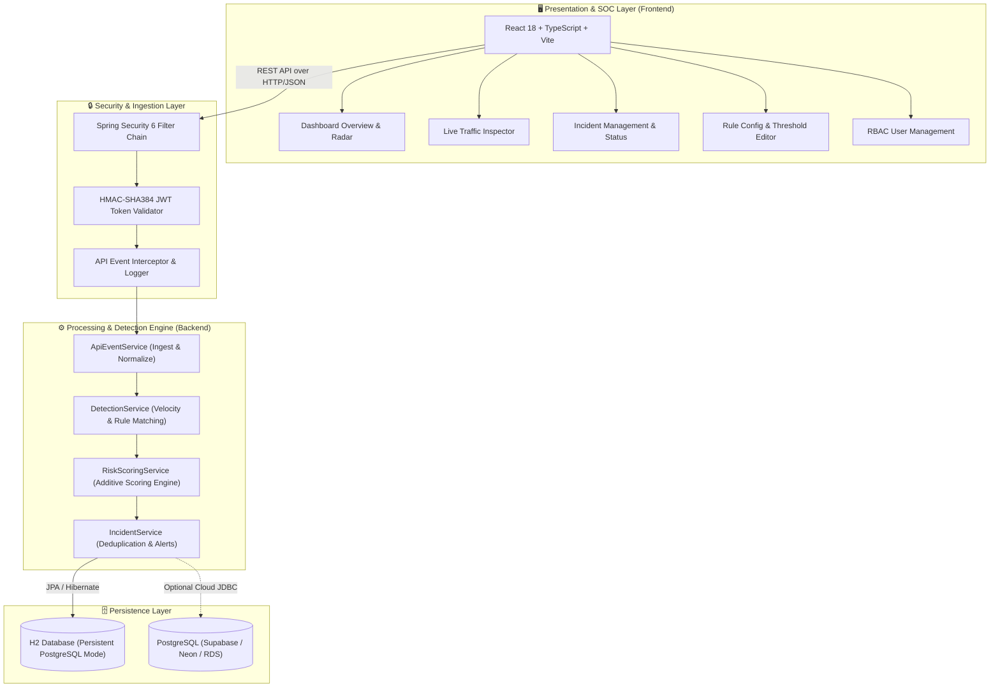
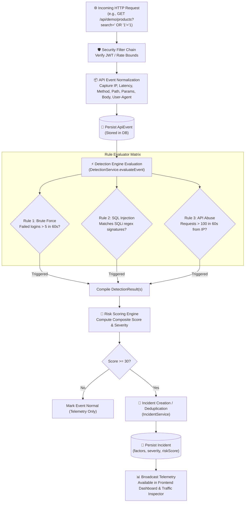
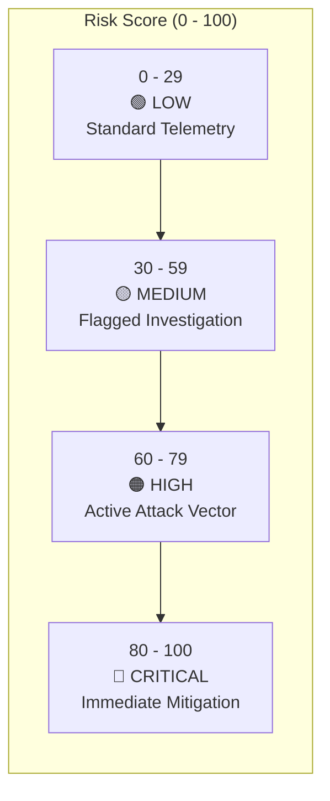
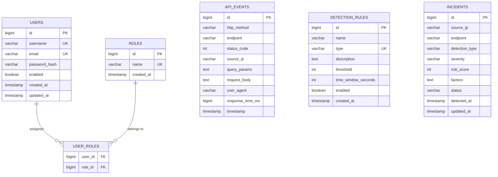
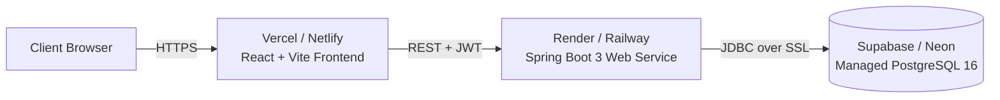

# 🛡️ API Sentinel — Enterprise API Intrusion Detection System

<div align="center">


<p align="center">
  <b>Autonomous, Real-Time API Intrusion Detection, Velocity Analytics & Security Operations Center (SOC)</b>
</p>

<p align="center">
  <a href="#-quick-start">Quick Start</a> •
  <a href="#-default-credentials">Credentials</a> •
  <a href="#-interactive-packet-flow-simulator">Flow Simulator</a> •
  <a href="#-system-architecture">Architecture</a> •
  <a href="#-end-to-end-data-flow">Data Flow</a> •
  <a href="#-control-flow--decision-tree">Control Flow</a> •
  <a href="#-risk-scoring-engine">Risk Engine</a> •
  <a href="#-attack-simulation-lab">Live Attacks</a> •
  <a href="#-api-reference">API Docs</a>
</p>

</div>

---

> [!NOTE]
> **One-Sentence Platform Overview:**  
> **API Sentinel** is an enterprise-grade API Security & Intrusion Detection System (IDS) that intercepts incoming REST traffic, extracts granular security metadata, detects active threats using deterministic velocity and signature rules, evaluates composite mathematical risk scores (0–100), and provides an ultra-low latency glassmorphism SOC dashboard for incident triage.

---

## ⚡ Quick Start

Launch both the **Backend Engine** and **Frontend SOC Dashboard** with a single command:

### Option A: One-Click Launchers (Recommended)

| Platform | Command / Action | Description |
|---|---|---|
| **Windows (Double-Click)** | Double-click [`run.bat`](file:///c:/java%20project/Sentinel-API/run.bat) | Auto-builds & boots Backend + Frontend in parallel |
| **Windows (PowerShell)** | `.\run.ps1` | Orchestrates processes with formatted status output |
| **Linux / macOS / WSL** | `chmod +x run.sh && ./run.sh` | Bash runner with port cleanup & health probes |
| **Node.js (Cross-Platform)** | `npm run dev` | Concurrently launches backend JAR & Vite dev server |

### Option B: Standalone Processes

<details>
<summary><b>▶️ Click to expand Backend standalone commands</b></summary>

```bash
# Using Maven Wrapper (Java 21):
cd backend
./mvnw spring-boot:run

# Or run pre-built JAR:
java -jar backend/target/api-0.0.1-SNAPSHOT.jar
```
*(Or double-click [`start-backend.bat`](file:///c:/java%20project/Sentinel-API/start-backend.bat))*

</details>

<details>
<summary><b>▶️ Click to expand Frontend standalone commands</b></summary>

```bash
cd frontend
npm install
npm run dev
```
*(Or double-click [`start-frontend.bat`](file:///c:/java%20project/Sentinel-API/start-frontend.bat))*

</details>

### 🌐 System Service Endpoints

Once booted, the following services will be live:

```
┌──────────────────────────────────────┬───────────────────────────────┐
│ Service Component                    │ Endpoint URL                  │
├──────────────────────────────────────┼───────────────────────────────┤
│ 🖥️  SOC Frontend Web UI              │ http://localhost:5173         │
│ 🛡️  Backend REST API Engine          │ http://localhost:8080         │
│ 🗄️  H2 Persistent Database Console   │ http://localhost:8080/h2-console│
│ 🩺 Health & Readiness Actuator      │ http://localhost:8080/actuator│
└──────────────────────────────────────┴───────────────────────────────┘
```

> **H2 Console Connection Info:**  
> - **Driver:** `org.h2.Driver`  
> - **JDBC URL:** `jdbc:h2:file:./data/sentineldb`  
> - **User:** `sa` | **Password:** *(empty)*

---

## 🔐 Default Credentials

API Sentinel ships with ready-to-test role-based accounts initialized via [`AdminBootstrapRunner.java`](file:///c:/java%20project/Sentinel-API/backend/src/main/java/com/sentinel/api/config/AdminBootstrapRunner.java):

```
┌───────────────────────┬──────────────┬──────────────┬─────────────────────────────────────────────────┐
│ Role Level            │ Username     │ Password     │ Access Permissions & Scope                      │
├───────────────────────┼──────────────┼──────────────┼─────────────────────────────────────────────────┤
│ 👑 Administrator      │ admin        │ admin123     │ Full System Control, Rules Tuning, RBAC Users   │
│ 🔍 Security Analyst   │ analyst      │ analyst123   │ Incident Triage, Status Lifecycle, Traffic Logs │
│ 👁️ Auditor / Viewer   │ viewer       │ viewer123    │ Read-Only Metrics, Telemetry & Dashboard View   │
└───────────────────────┴──────────────┴──────────────┴─────────────────────────────────────────────────┘
```

> [!TIP]
> The sign-in page ([`LoginPage.tsx`](file:///c:/java%20project/Sentinel-API/frontend/src/pages/LoginPage.tsx)) features **Quick Account Selection Chips** (`Admin`, `Analyst`, `Viewer`). Clicking any chip instantly pre-fills the credentials!

---

## 🎯 What Problem Does API Sentinel Solve?

Modern distributed applications expose hundreds of REST endpoints. Traditional network firewalls only inspect IP headers, while Web Application Firewalls (WAFs) struggle to correlate multi-request behavioral patterns. 

Threat actors leverage API-specific attack vectors:

| Attack Vector | Mechanism | Real-World Impact | How API Sentinel Mitigates It |
|---|---|---|---|
| **SQL Injection (SQLi)** | Tautologies (`' OR '1'='1`), stacked queries, comments, `UNION SELECT` | Unauthorized DB exfiltration, bypass auth | Instant regex AST signature scanning in query params & body payloads |
| **Brute Force & Credential Stuffing** | Rapid 401 velocity targeting `/api/auth/login` | Account takeover, credential dumping | Rolling 60s sliding window threshold (>5 fails = Critical Incident) |
| **API Abuse & Scraping** | High-concurrency requests (>100 req/min) | Denial of Service (DoS), business logic abuse | Per-IP request velocity monitoring with exponential risk weighting |
| **ID Enumeration** | Sequential traversal across numeric entity IDs | Bulk private data harvesting | Behavioral velocity and anomalous path dispersion tracking |

---

## 🎮 Interactive Packet Flow Simulator

Click each scenario below to inspect how the system evaluates different requests, step by step:

<details open>
<summary><b>🟢 Scenario 1: Legitimate API Traffic (Pass-Through)</b></summary>

```
[Client] ──HTTP GET /api/demo/products──▶ [Security Filter] ──Passed──▶ [ApiEvent Ingest]
                                                                               │
[Database: Normal Telemetry] ◀──Score: 0 (Normal)── [Detection Engine: 0 Matches] ◀──┘
```

1. **Client Request:** `GET /api/demo/products?category=electronics`
2. **Security Gateway:** Validates session / rate bounds $\to$ Allowed.
3. **Ingestion:** Normalized into an `ApiEvent` (Latency: 28ms, Status: 200).
4. **Detection Engine:** SQLi regex scan (negative), Brute force count (0), Velocity (within threshold).
5. **Risk Score:** `0` $\to$ Classification: **🟢 NORMAL**.
6. **Result:** Telemetry stored in database. No incident generated.

</details>

<details>
<summary><b>💉 Scenario 2: SQL Injection Attack (Signature Match)</b></summary>

```
[Attacker] ──GET /api/demo/products?search=' OR '1'='1──▶ [ApiEvent Normalizer]
                                                                   │
                                                                   ▼
[Incident INC-101 (MEDIUM: 30)] ◀──Score: 30── [Regex Match: SQL_INJECTION_PATTERN]
        │
        ▼
[SOC Dashboard Radar Alert]
```

1. **Malicious Query:** `GET /api/demo/products?search=%27%20OR%20%271%27=%271`
2. **Ingestion:** Encoded parameters decoded and parsed into `ApiEvent`.
3. **Detection Engine ([`DetectionService.java`](file:///c:/java%20project/Sentinel-API/backend/src/main/java/com/sentinel/api/service/DetectionService.java)):**
   - Matches regex: `('|\")\s*or\s+('?\d+'?|'?[a-zA-Z]+'?)\s*=\s*('?\d+'?|'?[a-zA-Z]+'?)`
   - Generates `DetectionResult` with type `SQL_INJECTION_PATTERN`.
4. **Risk Scoring ([`RiskScoringService.java`](file:///c:/java%20project/Sentinel-API/backend/src/main/java/com/sentinel/api/service/RiskScoringService.java)):**
   - Base contribution: `+30 points`.
   - Score: `30` $\to$ Severity: **🟡 MEDIUM**.
5. **Incident Service ([`IncidentService.java`](file:///c:/java%20project/Sentinel-API/backend/src/main/java/com/sentinel/api/service/IncidentService.java)):**
   - Deduplicates or creates `Incident` `INC-101`.
   - Factors JSON: `[{"factor": "SQL injection-like input detected", "points": 30}]`.
6. **Result:** Instantly surfaces on SOC Threat Radar and Incidents table.

</details>

<details>
<summary><b>💥 Scenario 3: High-Frequency Brute-Force Attack (Velocity & Context Multiplier)</b></summary>

```
[Botnet IP] ──7x Rapid POST /api/demo/login (401)──▶ [Sliding 60s Window Counter]
                                                                │
                                                                ▼
                                                [Threshold Breached: 7 > 5]
                                                                │
                                                                ▼
[SOC Critical Flash Alert] ◀──Score: 70 (HIGH)── [Risk: 50 Base + 20 Auth Context]
```

1. **Attack Pattern:** Bot fires 7 rapid login requests with incorrect credentials within 10 seconds.
2. **Detection Evaluation:**
   - Evaluator counts failed logins for IP `192.168.1.100` within a rolling 60-second window.
   - Count ($7$) exceeds threshold ($5$).
   - Rule `BRUTE_FORCE` is triggered.
3. **Risk Scoring:**
   - Base brute-force contribution: `+50 points`.
   - Context multiplier: Auth failure rate $>75\%$ adds `+20 points`.
   - Composite Score: `50 + 20 = 70` $\to$ Severity: **🟠 HIGH**.
4. **Result:** Escalated incident created, flagged with recommended IP block.

</details>

<details>
<summary><b>🌊 Scenario 4: API Rate Abuse & Scraping Flood</b></summary>

```
[Scraper] ──120 requests in 30s──▶ [ApiEvent Repository] ──Rolling 60s Count: 120──▶ [Threshold: >100]
                                                                                             │
[Incident: Excessive API Usage (Score: 30 - 45)] ◀──Rule Trigger: API_ABUSE ────────────────┘
```

1. **Attack Pattern:** Excessive calls (>100 requests in 60s) from a single IP to harvest endpoints.
2. **Rule Trigger:** `API_ABUSE` fires upon exceeding 100 requests.
3. **Risk Scoring:**
   - Base points: `+15`.
   - High velocity context: `+15`.
   - Score: `30–45` $\to$ Severity: **🟡 MEDIUM**.
4. **Result:** Incident logged with factor `"Excessive API usage"`.

</details>

---

## 🏛️ System Architecture

> 💡 **Interactive Diagram:** Click on **any node** below in your browser or Markdown viewer to jump directly to its code implementation!



---

## 🔄 End-to-End Data Flow

From the instant an HTTP request touches an endpoint to its visualization on the SOC radar:



---

## 🔀 Control Flow & Decision Tree

Trace how requests move across layers, when rules fire, and how incidents are deduplicated:

```mermaid
sequenceDiagram
    autonumber
    actor Attacker as Threat Actor / Client
    participant Controller as DemoController / Endpoints
    participant EventService as ApiEventService
    participant DetectService as DetectionService
    participant RiskEngine as RiskScoringService
    participant IncService as IncidentService
    participant SOC as Frontend Dashboard

    Attacker->>Controller: POST /api/demo/login (Bad Credentials)
    Controller->>EventService: recordEvent(ApiEvent: statusCode=401, IP=192.168.1.100)
    EventService->>DetectService: evaluateEvent(event)
    
    Note over DetectService: Query rolling 60s window from DB<br/>count = 6 failed logins for IP
    DetectService->>DetectService: Trigger BRUTE_FORCE rule
    
    DetectService->>RiskEngine: calculateScore([BRUTE_FORCE], Context)
    Note over RiskEngine: Base: +50 pts<br/>High Auth Failure Context: +20 pts<br/>Total: 70 pts (Severity: HIGH)
    RiskEngine-->>DetectService: RiskAssessment(score=70, severity=HIGH)
    
    DetectService->>IncService: handleDetections(event, detections, assessment)
    Note over IncService: Check active incident for IP<br/>Deduplicate or update score & timestamp
    IncService-->>SOC: Incident Available on Next Poll / Refresh
    SOC-->>SOC: Render Critical Flash & Incident Details Modal

    %% Interactive Links
    click Controller href "file:///c:/java%20project/Sentinel-API/backend/src/main/java/com/sentinel/api/controller/DemoController.java" "Open DemoController"
    click EventService href "file:///c:/java%20project/Sentinel-API/backend/src/main/java/com/sentinel/api/service/ApiEventService.java" "Open ApiEventService"
    click DetectService href "file:///c:/java%20project/Sentinel-API/backend/src/main/java/com/sentinel/api/service/DetectionService.java" "Open DetectionService"
    click RiskEngine href "file:///c:/java%20project/Sentinel-API/backend/src/main/java/com/sentinel/api/service/RiskScoringService.java" "Open RiskScoringService"
    click IncService href "file:///c:/java%20project/Sentinel-API/backend/src/main/java/com/sentinel/api/service/IncidentService.java" "Open IncidentService"
```

---

## 🧮 Risk Scoring Engine & Formula

The [`RiskScoringService.java`](file:///c:/java%20project/Sentinel-API/backend/src/main/java/com/sentinel/api/service/RiskScoringService.java) calculates a non-linear, multi-variable score bounded in $[0, 100]$:

$$\text{Risk Score} = \min\left(100, \sum \text{Base Points} + \sum \text{Context Boosts}\right)$$

### Factor Weighting Matrix

```
┌──────────────────────────────────────┬─────────────┬────────────────────────────────────────────────────────┐
│ Detection Factor                     │ Points      │ Condition Trigger                                      │
├──────────────────────────────────────┼─────────────┼────────────────────────────────────────────────────────┤
│ 💥 Brute-Force Behavior              │ +50 pts     │ > 5 failed auth attempts (401) from single IP in 60s   │
│ 💉 SQL Injection Input Signature    │ +30 pts     │ Query or Body matches compiled SQLi regex patterns     │
│ 🌊 Excessive API Usage (Abuse)       │ +15 pts     │ > 100 requests from single IP in 60s                   │
│ ⚠️ High Auth-Failure Rate Context    │ +20 pts     │ Window failure ratio > 75% under burst load            │
│ 📈 Excessive Request Activity Context│ +15 pts     │ Secondary velocity escalation from same origin         │
└──────────────────────────────────────┴─────────────┴────────────────────────────────────────────────────────┘
```

### Severity Classification Thresholds



---

## 🧪 Attack Simulation Lab (Live Testing)

Sentinel contains a built-in interactive honeypot/simulation controller ([`DemoController.java`](file:///c:/java%20project/Sentinel-API/backend/src/main/java/com/sentinel/api/controller/DemoController.java)). Try these attacks from your terminal:

### 1. SQL Injection Attack

Inject a tautological SQL exploit into the catalog search:

```bash
# cURL
curl "http://localhost:8080/api/demo/products?search=%27%20OR%20%271%27=%271"

# Or UNION SELECT attack:
curl "http://localhost:8080/api/demo/products?search=1%20UNION%20SELECT%20null,username,password%20FROM%20users--"
```

**Observation:**
- **Status:** Triggered immediately (`SQL_INJECTION_PATTERN`).
- **Severity:** `MEDIUM` (Score: 30) or `HIGH` if combined with velocity.
- **Factor:** `"SQL injection-like input detected"`.

---

### 2. High-Frequency Brute Force Attack

Run a rapid burst of failed credential attempts against the demo authentication gateway:

```bash
# Linux / macOS / Git Bash:
for i in {1..7}; do
  curl -s -X POST http://localhost:8080/api/demo/login \
       -H "Content-Type: application/json" \
       -d '{"username":"admin","password":"wrong_password_'$i'"}'
done

# PowerShell (Windows):
1..7 | ForEach-Object {
    Invoke-RestMethod -Uri "http://localhost:8080/api/demo/login" -Method POST `
        -ContentType "application/json" -Body "{`"username`":`"admin`",`"password`":`"bad_pass_$_`"}" `
        -SkipHttpErrorCheck
}
```

**Observation:**
- **Status:** Evaluator registers $>5$ 401 status codes in 60s.
- **Severity:** Escalates to `HIGH` / `CRITICAL` (Score: 70–90).
- **Factor:** `"Brute-force behavior"` + `"High authentication-failure rate"`.

---

### 3. API Rate Abuse / Scraping Flood

Flood the order management endpoint:

```bash
# PowerShell:
1..105 | ForEach-Object {
    Invoke-RestMethod -Uri "http://localhost:8080/api/demo/orders" -Method GET
}
```

**Observation:**
- **Status:** Ingestion records $>100$ requests within the 60-second window.
- **Severity:** `MEDIUM` (Score: 30–45).
- **Factor:** `"Excessive API usage"`.

---

## 🖥️ SOC Dashboard Features

The frontend is an ultra-modern, frosted glass Cyber SOC interface built with Tailwind CSS, Lucide icons, and React Router:

<details open>
<summary><b>✨ SOC Interface Highlights</b></summary>

1. **Dashboard Overview (`/overview`)**:
   - **Hero Threat Radar:** Dynamic SVG pulse radar displaying live system posture.
   - **Risk Area Trend Chart:** Real-time visual timeline of aggregated risk scores over time.
   - **Attack Vector Distribution:** Polar breakdown of active threat types (Brute-Force vs. SQLi vs. Abuse).
   - **Active Incidents Table:** Live table with severity pills, factor chips, and one-click drilldown.

2. **Incident Drilldown Modal & Lifecycle (`/incidents`)**:
   - Inspect IP, target endpoint, exact timestamps, and point-by-point factor contributions.
   - Update incident lifecycle status seamlessly:
     $$\text{OPEN} \longrightarrow \text{INVESTIGATING} \longrightarrow \text{RESOLVED}$$

3. **Live Traffic Inspector (`/traffic`)**:
   - Filterable stream of every recorded HTTP event with status codes, latency in ms, source IP, and user-agent string.

4. **Dynamic Rules Configuration (`/rules`)**:
   - Interactive toggles to enable/disable detection rules on the fly.
   - Real-time threshold adjustments (e.g., adjust brute-force trigger from 5 to 10 attempts).

5. **RBAC User Management (`/users`)**:
   - *Administrator only:* Create new analysts and viewers, inspect active credentials and creation audits.

</details>

---

## 🗄️ Database Schemas & Data Model



---

## 🔌 REST API Specification Reference

### Authentication & Users
- `POST /api/auth/login` — Authenticate and receive signed HMAC-SHA384 JWT.
- `GET /api/users` — *(ADMIN)* List all registered users and roles.
- `POST /api/users` — *(ADMIN)* Provision a new user account with role.

### Telemetry & Incidents
- `GET /api/dashboard/summary` — Aggregate metrics: total events, open incidents, severity counters.
- `GET /api/incidents` — List all captured incidents, ordered by most critical/recent.
- `GET /api/incidents/{id}` — Fetch detailed incident metadata and factor scores.
- `PATCH /api/incidents/{id}/status` — *(ADMIN/ANALYST)* Transition status (`OPEN`, `INVESTIGATING`, `RESOLVED`).
- `GET /api/events?limit=50` — Retrieve raw incoming API telemetry logs.

### Rules Management
- `GET /api/rules` — List all detection rules and current velocity thresholds.
- `PATCH /api/rules/{id}/enabled` — *(ADMIN)* Toggle rule activation state.
- `PUT /api/rules/{id}` — *(ADMIN)* Modify threshold count and time window seconds.

### Honeypot & Demo Simulation
- `POST /api/demo/login` — Test login endpoint for brute-force velocity.
- `GET /api/demo/products?search={payload}` — Test search endpoint for SQLi signatures.
- `GET /api/demo/orders` — Test orders endpoint for rate abuse simulation.

---

## 🚀 Cloud Deployment Guide

API Sentinel is built for effortless zero-cost cloud deployment:



| Component | Recommended Cloud Host | Setup Guide |
|---|---|---|
| **Database** | [Supabase](https://supabase.com) or [Neon](https://neon.tech) | Run [`seed_users.sql`](file:///c:/java%20project/Sentinel-API/backend/src/main/resources/seed_users.sql) in SQL Editor |
| **Backend** | [Render](https://render.com) or [Railway](https://railway.app) | Set `DB_URL`, `DB_USERNAME`, `DB_PASSWORD`, `JWT_SECRET` |
| **Frontend** | [Vercel](https://vercel.com) | Set `VITE_API_BASE_URL` to your backend Render URL |

*For complete step-by-step instructions with environment variable references, check the [Cloud Deployment Guide](docs/DEPLOYMENT_GUIDE.md).*

---

## 📂 Project Directory Structure

```text
Sentinel-API/
├── README.md                      # Comprehensive Architecture & System Guide
├── run.bat                        # Windows One-Click Batch Launcher
├── run.ps1                        # PowerShell Unified Process Orchestrator
├── run.sh                         # Linux / macOS / WSL Bash Runner
├── package.json                   # Root orchestrator scripts
├── start-backend.bat              # Standalone Backend launcher
├── start-frontend.bat             # Standalone Frontend launcher
│
├── backend/                       # Spring Boot 3 + Java 21 REST API Engine
│   ├── src/main/java/com/sentinel/api/
│   │   ├── config/                # SecurityConfig, AdminBootstrapRunner
│   │   ├── controller/            # Auth, Incident, Rules, Events, Demo APIs
│   │   ├── detection/             # DetectionResult data model
│   │   ├── dto/                   # Request/Response data transfer objects
│   │   ├── entity/                # ApiEvent, Incident, DetectionRule, User, Role
│   │   ├── repository/            # Spring Data JPA repositories
│   │   ├── security/              # JwtService, JwtFilter, CustomUserDetailsService
│   │   └── service/               # DetectionService, RiskScoringService, IncidentService
│   ├── src/main/resources/
│   │   ├── application.properties # H2 / PostgreSQL and JWT configs
│   │   └── seed_users.sql         # SQL migration script for initial users
│   └── pom.xml                    # Maven project descriptor
│
├── frontend/                      # React 18 + TypeScript + Vite Cyber SOC
│   ├── src/
│   │   ├── components/            # Layout, Navigation, Dashboard & Incident Modals
│   │   ├── context/               # AuthContext with auto-recovery
│   │   ├── pages/                 # Dashboard, Incidents, Traffic, Rules, Users, Login
│   │   ├── services/              # API Client (with offline fallback resilience)
│   │   └── styles.css             # Glassmorphism styling & animations
│   ├── vite.config.ts             # Vite development server & proxy config
│   └── package.json               # Frontend dependencies & scripts
│
└── docs/                          # Architecture & Deployment Documentation
    ├── DEPLOYMENT_GUIDE.md        # Cloud setup guide (Supabase + Render + Vercel)
    └── PROJECT_SPECIFICATION.md   # Architectural roadmap and specifications
```

---

<div align="center">
  <sub>Built with ❤️ by TriByte-Org • Protecting Cloud Endpoints in Real Time</sub>
</div>
